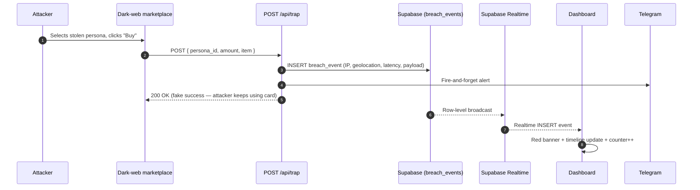

<div align="center">

# SyntheticTrap

### Don't prevent breaches. Catch them in seconds.

**Industry average breach detection time: 197 days.**
**SyntheticTrap: under 5 seconds.**

[](https://synthetictrap-io.vercel.app/)
[](https://nextjs.org)
[](https://www.typescriptlang.org)
[](https://supabase.com)
[](https://ai.google.dev)
[](#license)

**[Live demo](https://synthetictrap-io.vercel.app/) · [Dashboard](https://synthetictrap-io.vercel.app/dashboard) · [Attacker view](https://synthetictrap-io.vercel.app/trap)**

</div>

---

## The thesis

Every cybersecurity product ever built has tried to do one thing: **prevent** breaches. They all fail, because breaches are inevitable.

SyntheticTrap inverts the premise. We **assume** your database will be breached. We seed it with AI-generated synthetic customer records — **honeypots** — indistinguishable from real ones. The moment an attacker touches one of them, we know.

- Real customers: Luhn-invalid cards
- Synthetic honeypots: **Luhn-valid** cards that pass every client-side validator but never authorize
- Emails route to trap endpoints
- Trigger latency is logged to the millisecond

**197 days → seconds. A ~4,000,000× improvement on the metric that matters.**

---

## How it works



---

## Live routes

| Route | What you'll see |
|---|---|
| `/` | Cream Island landing page |
| `/dashboard` | Live forensic dashboard — stat cards, breach timeline, persona grid, realtime red banner |
| `/trap` | Dark-web marketplace (attacker view) — pick a stolen card, click Buy Now, watch `/dashboard` go red |
| `/api/health` | Diagnostic — env flags + DB counts |
| `/api/stats` | Dashboard summary counts |
| `/api/personas` | List / clear synthetic personas |
| `/api/breaches` | List / clear breach events |
| `/api/generate` | `POST { count }` → Gemini generates N personas |
| `/api/seed` | `POST` → inserts 950 dummy "real" customers |
| `/api/trap` | The critical webhook — fires on honeypot use |

---

## Quick start (local)

```bash
# 1. Clone and install
git clone https://github.com/VinayHadimani/synthetictrap-io.git
cd synthetictrap-io
npm install

# 2. Configure environment
cp .env.local.example .env.local   # or create manually — see below
# Fill in: NEXT_PUBLIC_SUPABASE_URL, NEXT_PUBLIC_SUPABASE_ANON_KEY,
#          SUPABASE_SERVICE_ROLE_KEY, GEMINI_API_KEY

# 3. Set up the database
# Open supabase/schema.sql, paste into Supabase SQL Editor, run it.

# 4. Seed the database
npm run dev
# In another terminal:
curl -X POST http://localhost:3000/api/seed         # 950 dummy customers
curl -X POST http://localhost:3000/api/generate \
  -H "Content-Type: application/json" -d '{"count":50}'   # 50 honeypots

# 5. Open the app
# http://localhost:3000/dashboard  (good guy view)
# http://localhost:3000/trap       (attacker view)
```

### Environment variables

| Key | Where to get it | Required |
|---|---|---|
| `NEXT_PUBLIC_SUPABASE_URL` | Supabase → Project Settings → API | Yes |
| `NEXT_PUBLIC_SUPABASE_ANON_KEY` | Same page | Yes |
| `SUPABASE_SERVICE_ROLE_KEY` | Same page — **server-only, never commit** | Yes |
| `GEMINI_API_KEY` | https://aistudio.google.com/apikey | Yes |
| `NEXT_PUBLIC_APP_URL` | `http://localhost:3000` locally | Yes |
| `TELEGRAM_BOT_TOKEN` | DM `@BotFather`, `/newbot` | Optional |
| `TELEGRAM_CHAT_ID` | DM `@userinfobot` | Optional |
| `GEMINI_MODEL` | Defaults to `gemini-2.5-flash` | Optional |

---

## A note on Gemini free-tier quota

Gemini 2.5 Flash's free tier allows **20 requests per day per project**. Generating 50 personas in one sitting requires a fresh quota — if you hit the limit, wait 24h or swap to a different model via `GEMINI_MODEL`.

The production demo currently ships with **19 honeypots** for exactly this reason. The system is designed to work at any scale; 19 already demonstrates the full pipeline.

---

## Architecture

```
├── app/
│   ├── page.tsx                    # Cream Island landing
│   ├── dashboard/page.tsx          # Forensic dashboard (realtime)
│   ├── trap/page.tsx               # Dark-web marketplace (attacker view)
│   └── api/
│       ├── health/route.ts         # Diagnostic
│       ├── stats/route.ts          # Dashboard counts
│       ├── personas/route.ts       # List / clear personas
│       ├── breaches/route.ts       # List / clear breaches
│       ├── generate/route.ts       # Gemini → personas
│       ├── seed/route.ts           # Dummy customers
│       └── trap/route.ts           # The critical webhook
├── components/
│   ├── LiveAlertBanner.tsx
│   ├── StatsCards.tsx
│   ├── BreachTimeline.tsx
│   ├── PersonaGrid.tsx
│   └── Logo.tsx
├── lib/
│   ├── luhn.ts                     # Luhn-valid synthetic card generator
│   ├── persona-generator.ts        # Gemini integration + rate-limit-aware batching
│   ├── telegram.ts                 # Optional Telegram alerts (graceful degradation)
│   ├── geo.ts                      # Best-effort IP geolocation
│   ├── utils.ts
│   └── supabase/{client,server}.ts
└── supabase/
    └── schema.sql                  # Run once in Supabase SQL Editor
```

---

## Tech stack

- **Framework**: Next.js 14 (App Router, TypeScript)
- **Styling**: Tailwind CSS with a custom dual-palette theme (`trap`/`honeypot` for the dark forensic surfaces, `cream`/`ink`/`violet`/`coral` for the landing page)
- **Database**: Supabase (Postgres + Realtime + RLS)
- **LLM**: Google Gemini 2.5 Flash
- **Icons**: lucide-react
- **Deploy**: Vercel
- **Cost**: ₹0 — every service is on a free tier

---

## Design notes

Three deliberately different visual identities, one per surface:

| Surface | Palette | Feel |
|---|---|---|
| `/` landing | Cream `#FFF0DF` + charcoal ink + one violet device mockup | Apple-adjacent, calm, premium |
| `/dashboard` | Zinc-950 + red accents + monospace | Security operations center |
| `/trap` | Pitch black + neon green + scanlines | Dark-web marketplace |

The contrast is intentional — it tells the story in three color systems: **consumer product → serious security tooling → attacker's playground.**

---

## License

MIT — see [LICENSE](LICENSE) if present, otherwise free to use, modify, and ship.

---

<div align="center">

**197 days → 4 seconds.**

Built for HackOverflow 10.0.

</div>
