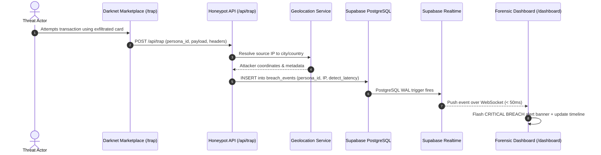

# SyntheticTrap 🪤⚡

> **Zero-Dwell-Time Breach Detection via AI-Generated Honeypots**  
> Compress enterprise breach detection latency from the industry average of **197 days** down to **sub-second real-time detection**.

[](https://synthetictrap-io.vercel.app)
[](https://nextjs.org/)
[](https://supabase.com/)
[](https://ai.google.dev/)

---

## 🎯 The Problem

According to IBM's *Cost of a Data Breach Report*, the average time to identify a data breach is **197 days**. Attackers silently exfiltrate database records, package them into credential dumps, and distribute them across illicit forums—leaving organizations unaware until their compromised data surfaces months later.

## 🛡️ The Solution

**SyntheticTrap** seeds your production customer database with high-fidelity, AI-generated synthetic "canary" personas. These records:
- Look, validate, and behave like legitimate customer accounts.
- Feature Luhn-valid card numbers, plausible addresses, and rich backstories generated via **Gemini 2.5 Flash**.
- Carry an immutable forensic honeypot signature.

When threat actors breach the database and attempt to monetize or use a synthetic identity on a marketplace or payment gateway, **SyntheticTrap trips instantly**. The system extracts attacker telemetry (IP, location, user-agent) and broadcasts an alert to security teams in **milliseconds**.

---

## 🏗️ Architecture & Breach Pipeline



---

## ✨ Features

- **Gemini 2.5 Flash Persona Generator**: Programmatically generates culturally coherent, realistic synthetic identities that blend seamlessly with real customer data.
- **Luhn-Valid Payment Credentials**: Generates structurally valid Visa test cards (`400000...`) that pass automated validator checks without belonging to real individuals.
- **Sub-Second Detection Engine**: Captures trigger events and computes exact detection latency (`occurred_at - created_at`).
- **Real-Time Forensic Command Center**:
  - Live incident alert banner with audio/visual flash cues.
  - Interactive attack timeline showing geographic attribution and payload data.
  - Persona inventory inspector with search and trap signatures.
- **Dual-Palette Aesthetic Design**:
  - **Cream Island (`/`)**: Warm, refined high-contrast editorial aesthetic for enterprise overview.
  - **Dark Forensic (`/dashboard`)**: High-density cyber telemetry console for SecOps teams.
  - **Darknet Marketplace (`/trap`)**: CRT green-screen terminal simulator for live demonstration.

---

## 🌐 Live Application Routes

| Path | Description | Theme |
| :--- | :--- | :--- |
| [`/`](https://synthetictrap-io.vercel.app/) | Marketing & Product Architecture Overview | Cream Island (`#FFF0DF`) |
| [`/dashboard`](https://synthetictrap-io.vercel.app/dashboard) | Live Realtime Threat Monitoring Center | Dark Forensic (`#09090B`) |
| [`/trap`](https://synthetictrap-io.vercel.app/trap) | Simulated Illicit Marketplace Honeypot Trigger | Terminal Green CRT |
| [`/api/health`](https://synthetictrap-io.vercel.app/api/health) | Diagnostic health & environment inspector | JSON |
| [`/api/stats`](https://synthetictrap-io.vercel.app/api/stats) | Dynamic summary metrics & detection latency | JSON |

---

## 🚀 Getting Started

### 1. Prerequisites
- Node.js 18.17+ or Node.js 20+
- A [Supabase](https://supabase.com/) project
- A [Google AI Studio](https://aistudio.google.com/) API key (Gemini 2.5 Flash)

### 2. Clone and Install Dependencies

```bash
git clone https://github.com/VinayHadimani/synthetictrap-io.git
cd synthetictrap-io
npm install
```

### 3. Database Setup

Execute the schema migration in your Supabase SQL Editor:
- Navigate to **Supabase Dashboard** → **SQL Editor** → **New Query**.
- Paste and run the contents of [`supabase/schema.sql`](./supabase/schema.sql).

This sets up:
- `personas` (synthetic honeypot records)
- `customers` (baseline customer pool)
- `breach_events` (audit logs with realtime replication)
- Row Level Security (RLS) policies

### 4. Configure Environment Variables

Create `.env.local` in the project root:

```env
# Supabase Configuration
NEXT_PUBLIC_SUPABASE_URL=https://your-project.supabase.co
NEXT_PUBLIC_SUPABASE_ANON_KEY=your-anon-publishable-key
SUPABASE_SERVICE_ROLE_KEY=your-service-role-key

# Google AI Studio
GEMINI_API_KEY=your-gemini-api-key

# Application URL
NEXT_PUBLIC_APP_URL=http://localhost:3000

# Optional: Telegram Alerts
TELEGRAM_BOT_TOKEN=
TELEGRAM_CHAT_ID=
```

### 5. Run the Local Development Server

```bash
npm run dev
```

Visit [http://localhost:3000](http://localhost:3000) in your browser.

---

## 🧪 Testing the Live Breach Flow

1. Open `/dashboard` in **Tab A**.
2. Open `/trap` in **Tab B**.
3. Select an item and any synthetic persona from the inventory drop, then click **BUY NOW**.
4. Switch to **Tab A**: the red **CRITICAL BREACH DETECTED** banner triggers instantaneously without page reload.

---

## 🔒 Security & Privacy

SyntheticTrap is designed specifically as an enterprise defensive honeypot solution. Generated persona data is completely synthetic and generated on-the-fly; credit card numbers use safe test prefixes that cannot process real-world monetary transactions.

---

## 📄 License

MIT © [Vinay Hadimani](https://github.com/VinayHadimani)
